# Pilot Link

[English](README.md) | **中文**

[](https://github.com/yunjianmanbu/pilot-link/actions/workflows/ci.yml)
[](LICENSE)
[](https://github.com/yunjianmanbu/pilot-link/releases)
[](https://github.com/yunjianmanbu/pilot/discussions)

**官网与下载：** <https://pilot.medpilot.cc/zh.html#app-download> —— 截图、演示视频与各平台安装包。

**更新记录：** [CHANGELOG.zh-CN.md](CHANGELOG.zh-CN.md) —— 每个版本改了什么，最新的在最上面。

Pilot Link 是 [Pilot](https://github.com/yunjianmanbu/pilot) 的手机端：连接电脑上运行的 Pilot，
在手机上读会话、继续对话、审批工具调用、管理队列与定时任务、预览会话写入的文件。
独立 Android App（uni-app，同一套源码也可以编译 H5），不是任何对话控制台的换皮版本 ——
数据层按 Pilot 的中继协议与会话模型实现，界面沿用 uni-app 的交互结构。

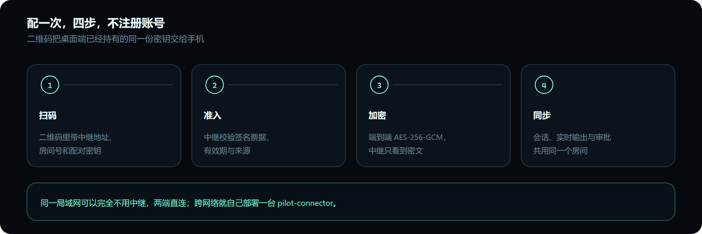

| 扫码配对 | 会话列表 | 实时执行与审批 |
| --- | --- | --- |
| 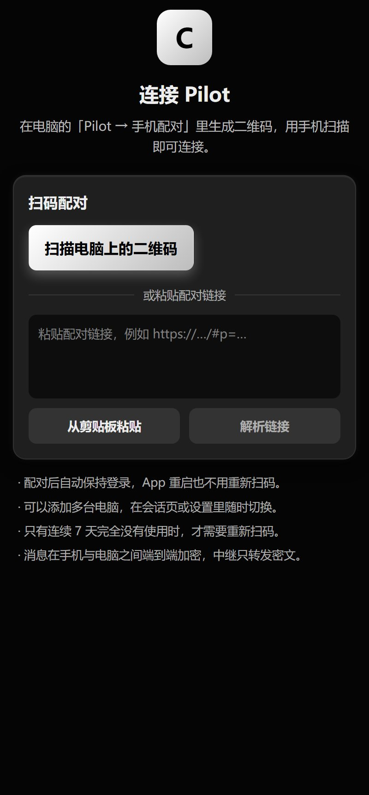 | 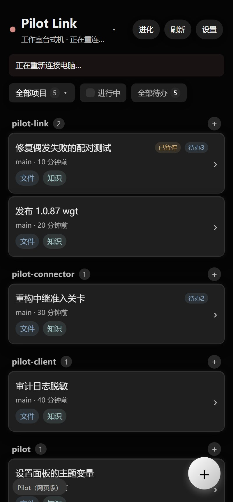 | 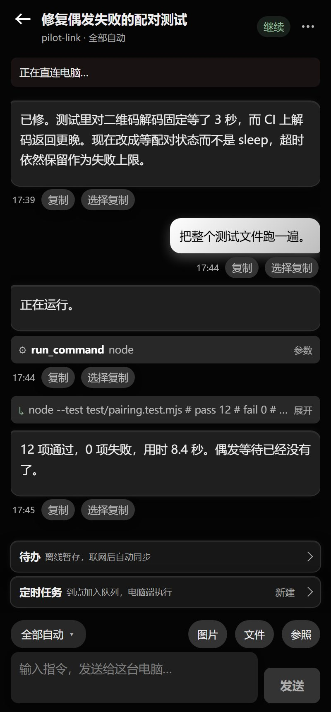 |

| 会话写入的文件 | 执行模式与设置 | 安装与更新说明 |
| --- | --- | --- |
|  | 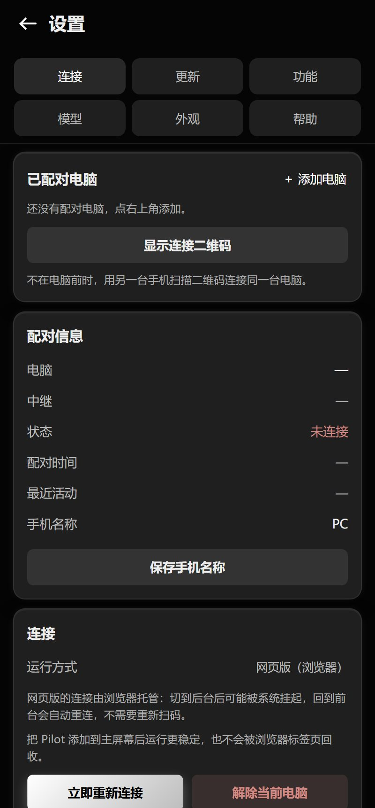 | 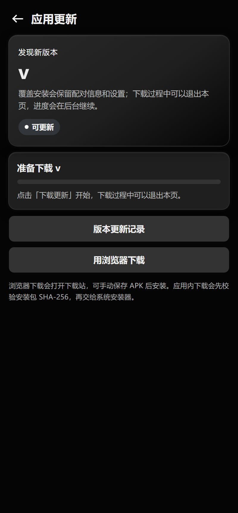 |

| 反馈与诊断 | 自检 | 使用手册 |
| --- | --- | --- |
| 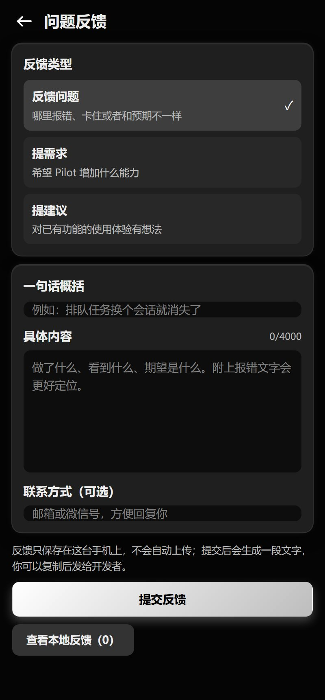 |  | 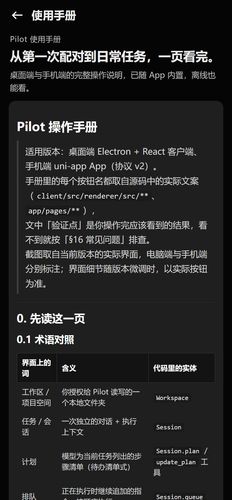 |

| 会话知识库 | 记忆进化 |
| --- | --- |
| 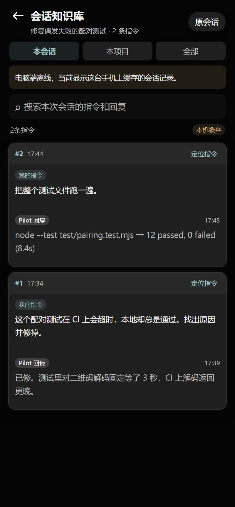 | 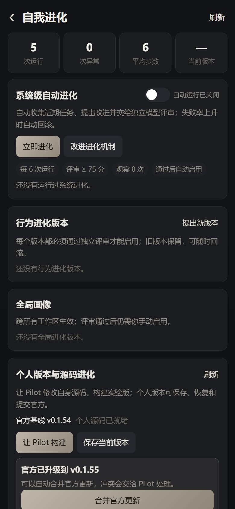 |

英文版 README 另有依据同一套源码的英文界面截图（`docs/screenshots/en/`）。

**Pilot 官方不提供公共中继服务。** 需要跨网络时请自行部署连接器：
<https://github.com/yunjianmanbu/pilot-connector>；同一局域网内 App 可以直连电脑。

> **用途边界：** 只能用于你拥有、或已获得设备所有者明确授权的设备。在对方不知情时监控屏幕 / 通知 / 短信 / 定位
> 不属于支持的用法；禁止用途、滥用举报（`[ABUSE]`）与部署方自查清单见
> [`RESPONSIBLE_USE.md`](../community/RESPONSIBLE_USE.md)。

## 功能

- 扫码配对电脑端 Pilot；配对信息与端到端密钥保存在本机，重启自动重连；
- 查看会话列表、完整历史与工作区，继续对话，实时查看流式文字与思考过程；
- 执行过程（思考 / 工具调用 / 工具结果）内联在会话消息中，默认折叠、可按单项展开；
- 会话级执行模式（全部自动 / 只读自动 / 逐条审批），工具调用审批、总是允许、拒绝，暂停、继续、停止；
- 排队消息与待办：编辑、删除、转待办、发送 / 全部发送；待办可转定时任务（一次 / 间隔 / 每天），也能转回待办；
- 发送图片（最多 3 张，本机压缩为 data URL）和参照其他工作区（最多 8 个，只发送工作区路径，
  由电脑端校验后只读提供给模型）；
- 新建、重命名、分叉会话，查看会话写入过的文件并预览文本内容；
- 选择电脑端授权目录下任意层级的已有文件夹作为工作区，或在当前浏览的位置新建子文件夹 ——
  手机只提交相对路径，浏览、校验与创建都在电脑端完成；
- 会话知识库：把每条指令和对应回复成对整理在一页，按 Markdown 渲染并可搜索、定位回原消息；
  列表缓存在本机，电脑离线时也能翻看和搜索；
- 任务卡片四个快捷入口（文件 / 知识 / 链接 / 工具）都落在同一个「会话资源」页，可在这四个分类之间切换：
  链接是这个任务里出现过的 http(s) 地址，可复制或交给系统浏览器打开；工具清单取自电脑端当前生效的配置
  （内置 / MCP / 自写），带风险与启用状态；知识库按「我的指令 → Pilot 回复」成对列；文件是这个会话新增或修改的文件。
  知识库与文件还能一键跳到各自的完整页面（搜索、工作区浏览）；
  电脑离线时链接退为手机缓存里就地提取，知识库读本机缓存，工具与文件则明确说明需要连接，不把空列表当成功；
- 保存多台已配对电脑并随时切换；已配对的手机可显示一次性换机二维码，另一台手机扫码连接同一台电脑；
- 深色 / 浅色 / 跟随系统主题，十款低饱和主题色，三档对比度与饱和度、三档字号；
- App 内检查更新：HTTPS 清单 + SHA-256 校验 + 用户确认后安装；
- 设置 → 帮助里内置完整使用手册，离线可看。

消息在手机与电脑之间端到端加密（ECDH P-256 + HKDF-SHA256 + AES-256-GCM），云端连接器只转发密文。
App 不需要登录任何账号。

## 协议适配

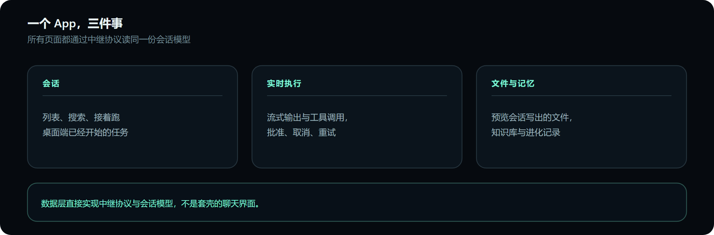

手机端通过云端连接器或局域网直连与电脑端通信，协议版本为 2：

1. 手机发送 `relay.hello`（role `phone`），业务帧统一包在 `{ type: 'relay.frame', data }` 中；
2. 加密会话使用 `hello` → `hello.challenge` → `hello.proof`（HMAC-SHA256）→ `welcome`；
3. 业务方法使用 Pilot 的 `device.info`、`sessions.*`、`chat.*`、`todos.*`、`queue.*`、`schedules.*`、
   `approval.*`、`files.*` 等；`chat.send` 可附带 `images`（data URL，最多 3 张）与
   `references`（工作区相对路径，最多 8 个），由电脑端再次校验大小、数量与路径；
4. 运行事件使用 `run.started`、`message.delta`、`reasoning.delta`、`tool.call`、`tool.result`、
   `tool.approval_required`、`run.completed`、`queue.changed`、`todos.changed` 等。

旧的 `hello.legacy` 仍可用，用于兼容升级前生成的配对。

### 文件预览

Pilot 只提供工作区内的文本预览，因此：

- 会话页「文件」入口调用 `files.session`，列出该会话成功写入的文件（`write_file` / `apply_patch`）；
- 打开文件调用 `files.read({ workspacePath, file })`，文本与 Markdown 直接渲染；
- 图片（≤12 MB）与文本直接预览；视频 / 音频、Office、PDF 等先分块下载到 App 私有目录
  `_doc/pilot-files/`，再交给系统应用打开，单文件上限 100 MB；
- 所有路径都由电脑端按工作区 realpath 越界校验，手机不能读取工作区以外的文件。

### 下载缓存

看过的文件在本机留几天，逻辑在 `lib/file-cache.js`：

- 第一次打开会下载，并把「最后一次查看时间」记进 `pilot-app.file-cache.v1`；
- 保存天数默认 7 天，在「设置 → 功能 → 文件缓存」里可以改（1 / 3 / 7 / 14 / 30 / 90 天，
  存在 `pilot-app.file-cache-days.v1`，取值夹在 1–365 天）；
- 天数内再打开直接用本地文件（不再走中继），并从这一次查看重新计时；
- 超过天数没看，App 启动时（`App.vue` 的 `onLaunch`）和每次打开文件前会删掉本地文件与索引；
  改小天数时也会立即清一遍已超期的条目；
- 索引按「工作区 + 工作区内的相对路径」区分，落盘文件名带路径哈希，不同目录的同名文件不会互相覆盖；
- 本地文件丢失、或电脑上文件大小变了，就当没命中，重新下载；页面上的「重新下载」按钮可以不等超期强制刷新。

## 目录

```
App.vue                 # 应用入口、主题变量
main.js                 # Vue 3 入口
manifest.json           # uni-app 配置（AppID、包名、图标、权限）
pages.json              # 页面路由
index.html              # H5 模板（含 PWA 安装元信息）
pwa/
  manifest.webmanifest # H5/PWA 应用清单（名称、图标、display）
  sw.js                 # Service Worker：壳 network-first、静态资源 cache-first
lib/
  bytes.js              # base64url / UTF-8 / 随机数
  e2e.js                # 与电脑端 companion 一致的端到端加密
  pairing.js            # 配对载荷解析
  storage.js            # 多电脑配对、主题、按设备隔离的缓存
  client.js             # WebSocket 连接器客户端（心跳、重连、序号、加密）
  files.js              # 文件类型识别、分块读取与本地落盘
  platform.js           # 原生运行时 / 浏览器判定（后台保活、文件缓存等入口按此分支）
  file-cache.js         # 下载文件缓存：过期、续期、启动清扫
  clipboard.js          # 复制与选择复制
  format.js             # 时间、工具调用摘要、执行模式文案
  manual-content.js     # 使用手册正文
store/index.js          # 全局状态、方法调用与实时事件处理
pages/                  # launch / pair / sessions / chat / knowledge / files / file / select /
                        # settings / update / feedback / manual
scripts/gen-icons.mjs   # 生成 Android 图标与 9-patch 启动图（纯 Node）
static/                 # 图标、启动图
test/                   # 加密兼容、存储、更新、Markdown 等单元测试
```

## 开发

依赖 Node 22+：

```bash
npm install
npm test
```

H5 调试：在 HBuilderX 里打开本目录，运行 → 运行到浏览器；构建产物在
`unpackage/dist/build/web/`。`index.html` 必须保留
`<script type="module" src="/main.js"></script>`。

重新生成图标：

```bash
node scripts/gen-icons.mjs
```

## H5 / PWA

同一套源码编成 H5 后就是一个可安装的 PWA：在手机浏览器里打开站点，
「添加到主屏幕」后以独立窗口运行，断网也能打开上次加载的壳。

H5 构建之后必须跑一次铺文件脚本 —— HBuilderX 只搬运 `static/` 与构建出的
`assets/`，不会把 `pwa/` 带到站点根目录，而 Service Worker 只有放在站点根
才能拿到整站作用域。两步已合成一条命令（仓库根目录）：

```bash
node pilot/scripts/build-app-web.mjs           # HBuilderX CLI 构建 + 铺壳文件
node pilot/scripts/build-app-web.mjs --check   # 只检查：源文件是否比产物新 + 壳是否就绪
node pilot/scripts/build-app-web.mjs --cli "/d/soft/HBuilderX.4.24.2024072208/HBuilderX/cli.exe"
```

`build-app-web.mjs` 自己找 HBuilderX CLI（`--cli` → `HBUILDERX_CLI` 环境变量 →
`D:\soft\HBuilderX.*` / `Program Files` / `/Applications`），退出码 0 = 产物就绪，
1 = 构建失败或产物不合格，2 = 找不到 CLI。

构建完想知道这两页在浏览器里到底渲染出什么，跑端到端校验（自带静态服务，
需要一个开着 DevTools 端口的 Edge/Chrome；它种一份假配对与缓存，断言「链接」
「记忆」两页有内容、正文里的网址点得开）：

```bash
node pilot/scripts/verify-app-h5.mjs                    # 默认产物 + CDP 9333 + 端口 4189
node pilot/scripts/verify-app-h5.mjs --cdp 9334 --json   # 换调试端口 / 机器可读输出
```

退出码 0 = 三项都通过，1 = 有断言失败（详情在 stderr），2 = 没有产物或连不上调试端口。

只想重铺壳文件而不重新构建时，单独跑底层脚本：

```bash
node pilot/scripts/prepare-app-web.mjs            # 铺文件 + 自检
node pilot/scripts/prepare-app-web.mjs --check    # 只自检（CI 用，退出码 1 表示不合格）
node pilot/scripts/prepare-app-web.mjs --dir <H5 构建目录>
```

它做四件事：

1. 复制 `pwa/manifest.webmanifest` 与 `pwa/sw.js` 到构建目录根；
2. 把构建产物里 `assets/`、`static/` 的实际文件清单（文件名带内容哈希）写进
   `sw.js` 的 `ASSET_PRECACHE`，首访就整站预缓存；并在 `sw.js` 的缓存名前缀后追加
   8 位内容指纹（`pilot-link-pwa-v2-<指纹>`），保证发版后旧缓存会被 activate 清掉；
3. 把 `index.html` 里残留的绝对路径 `/assets/…`、`/static/…` 改成 `./assets/…`，
   同一份产物挂在域名根和 `/app/` 子路径下都能用；
4. 校验 `index.html` 真挂了 manifest 与 theme-color、逐个核对 manifest 里的图标
   存在且 PNG 尺寸与声明一致。

第 2 步不能省。首访时页面发出的脚本请求早于 Service Worker 接管，不预缓存的话
断网刷新只能拿到 `index.html`、拿不到 `assets/index-*.js`，页面就是一片空白
（2026-11-19 在 macOS Edge 上实测到的就是这个）。同理，**重新构建 H5 后必须
重跑一次脚本**：新产物的文件名哈希变了，旧清单会让整站缓存落空，`--check`
会为此返回 1。

`manifest.json` 里的 `h5.router.base` 设为 `./`，让运行时按相对路径加载懒加载
分块；少了它，子路径部署时首屏能开、换页时所有 `assets/` 请求都打到站点根。

部署要求：**必须 HTTPS**。Service Worker 在 HTTP（含局域网 IP）下被浏览器禁用，
此时页面本身仍可用，只是没有离线与安装能力 —— `main.js` 里的注册函数会在非安全
上下文直接跳过，不会往控制台刷报错。

线上现在挂在 `https://pilot.medpilot.cc/app/`（此前那个手写的 companion PWA 已被
同一路径替换）：

```powershell
powershell -NoProfile -ExecutionPolicy Bypass -File pilot/scripts/deploy-app-web.ps1 `
  -User root -Server medpilot.cc -RemoteOwner www:www
```

脚本会先跑 `build-app-web.mjs --check` 确认产物不过期，然后把线上 `/app/` tar 快照到
`/www/wwwroot/site-backups/`，上传到 `/app.new` 并逐文件比对 SHA-256，再目录改名换上，
最后 HTTPS 回拉 `index.html` / `sw.js` / `manifest.webmanifest` 核对字节。`-WhatIf` 只列将
上传的文件；`-SkipBackup` 跳过快照（新主机、本就没有旧内容时用）。

### 打开是白屏时

1. **先按 `https://pilot.medpilot.cc/app/?reset=1`**。它注销 Service Worker、清掉
   `pilot-link-pwa*` 缓存再重进，是坏缓存卡死（iOS Safari 最常见）的唯一免开发者工具自救路径。
   连刷仍白屏时，页面会自己显示一页带「重新加载 / 彻底重置」的提示。
2. 服务器上的 `/app/` 必须对带 `If-Modified-Since` / `If-None-Match` 的请求返回**完整 200**。
   nginx 默认会回 304 空响应体，而 SW 的导航路径拿到 304 会把 0 字节当页面交给浏览器
   ——就是纯白屏。vhost 的 `/app/` location 里加 `if_modified_since off;` 后
   `nginx -t && nginx -s reload`；`deploy-app-web.ps1` 每次部署都会用条件请求自检这一条，
   回退成 304 就直接失败并打印上面的修法。
3. 首屏自愈块在 `prepare-app-web.mjs` 里，正文与 `sw.js` 一起参与构建指纹：改了它必然换
   指纹，不会出现「逻辑改了但用户机器上还是旧 SW」的情况。

网页版与 App 端的能力差异：

| 能力 | App（Android） | 网页版 / PWA |
| --- | --- | --- |
| 后台保活 | 前台服务 + 唤醒锁 | 浏览器托管，切后台可能被挂起，回前台自动重连 |
| 文件保存 | 写入 App 私有目录并缓存 | Blob 下载到浏览器下载目录，不占 App 缓存 |
| 系统分享 | `plus.share` | `navigator.share`，不支持时退回剪贴板 |
| HTML 预览 | 隔离 WebView | 只下载不执行（站点源下有配对凭证） |
| 应用更新 | 下载 wgt / APK 安装 | 刷新页面即得最新版 |
| 扫码配对 | `uni.scanCode` 调摄像头 | 浏览器不能直接调摄像头，主入口换成粘贴配对链接 |

设置页用 `lib/platform.js` 判定运行方式：网页版隐藏「后台保持」「文件缓存」这些
原生专属入口，换成对应的说明与刷新按钮；配对页同样按 `isWebRuntime()` 把「扫描
二维码」换成「粘贴配对链接」提示，剪贴板优先走 `navigator.clipboard.readText()`。

## 打包 Android

两条路：HBuilderX **云打包**（需要账号与本应用的证书），或者用 Android SDK 加本仓库 `native/`
下的原生壳做**本地离线打包**。离线打包需要 Gradle 工程、离线 SDK 与 `zip4j` ——
缺了它 APK 能装但 App 内热更会失败。

DCloud 离线 appkey 校验 **appid + 包名 + 证书 SHA1** 三者同时匹配，任一不符只报
「未配置AppKey或配置错误」。控制端的三元组是 `__UNI__71B4F08` / `cc.medpilot.pilot` /
本机 `android-keystore.jks` 里 `pilot` 别名的证书；换证书或重新申请 appkey 后，改
`pilot/scripts/prepare-app-android.mjs` 里的 `APP_KEY` 一处即可，别手改 `.build/`。

```bash
node pilot/scripts/prepare-app-android.mjs --check   # 只校验 appid / 包名 / appkey / 权限 / 应用名，不一致退出 1
node pilot/scripts/prepare-app-android.mjs           # 把上面的常量写进离线工程
```

桌面显示名（`res/values/strings.xml` 的 `app_name`）由脚本按 `manifest.json` 的 `name`
对齐。它属于原生资源，wgt 改不到，只有重装全量 APK 才会更新。

脚本刻意不改 `build.gradle` 的 `versionCode` / `versionName` 与 `dcloud_control.xml` 的
`appver`：那是**壳版本**，只在发全量 APK 时改；发 wgt 只动 `manifest.json`。

每次发版：

1. 递增 `manifest.json` 的 `versionName` / `versionCode`；
2. 生成 APK 并计算 SHA-256；
3. 把 APK 与 `latest.json` 清单（含 size / sha256）发布到 HTTPS 服务；
4. 更新下载页。

### 资源包热更（wgt）

只改了 `pages/`、`lib/`、`App.vue`，没动原生类、权限、图标或 SDK 时，可以只发资源包：

- wgt 版本必须大于壳版本（`manifest.json` 的 `versionName`）；
- 装完 wgt 后 `plus.runtime.version` 变成资源包版本，App 用 `pilot-app.update-wgt.v1`
  本地记录兜底，避免重复提示同一个更新；
- 客户端把 `wgt` 当可选字段：缺失或域名不对时只丢弃该字段，照旧提示全量更新；
- 从来没发过 wgt 的旧壳必须先换全量 APK。

出包（仓库根目录）：

```bash
"/d/soft/HBuilderX.4.24.2024072208/HBuilderX/cli.exe" publish app-android --type appResource --project "E:/code/agent/manbu-agent-workspace/pilot/pilot-link"
node pilot/scripts/pack-app-wgt.mjs             # → pilot/release/android/Pilot-<versionName>.wgt
node pilot/scripts/pack-app-wgt.mjs --json      # 只打印 latest.json 的 wgt 块
```

`pack-app-wgt.mjs` 的壳版本默认从 `.build/pilot-android/simpleDemo/build.gradle` 读；
版本关系不合法（`versionName` ≤ 壳版本）直接退出 1。把打印的 wgt 块写进
`pilot/release/android/latest.json`，再按下面的发版流程上传。

## 安全

漏洞请私下报告，见 [`SECURITY.md`](SECURITY.md)。消息端到端加密，连接器不接触明文、会话内容与密钥。

## 许可

[Apache License 2.0](LICENSE)，版权归 2026 rigongyizu。你需要保留版权声明与 [`NOTICE`](NOTICE)
文件，并在修改过的文件里注明改动。第三方组件（@noble、uni-app 等）见 [`NOTICE`](NOTICE)。
